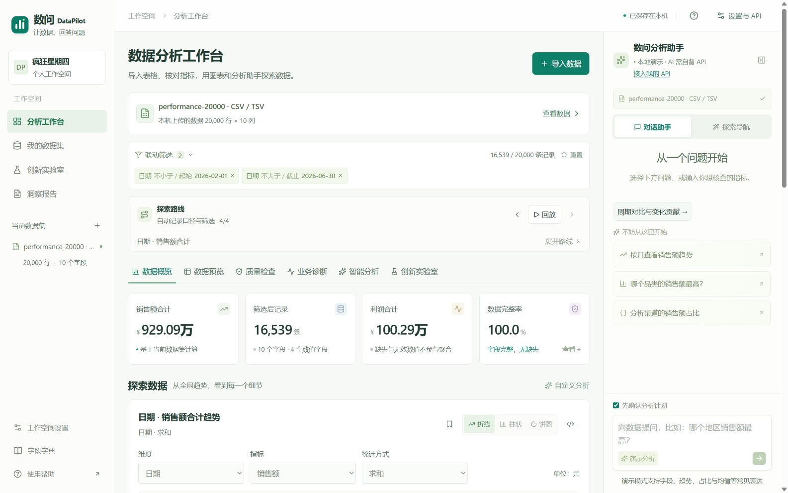
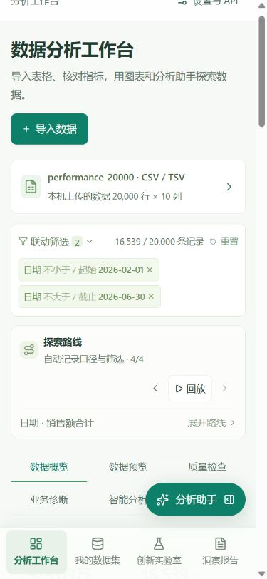

# v0.6.2 页面交互与阅读体验验收

日期：2026-10-26。此轮调整界面和交互，保留访客个人API接入方式及原有数据计算功能。

## 本轮变更

- 正文15px，常用操作14–16px，辅助文字至少13px，图表坐标标注13px；提高说明文字和导航对比度。
- 移除创新实验室旁的收藏计数、页签栏右侧的重复导出按钮、静态工作空间下拉箭头、虚拟用户展示和重复新手提示。报告导出在洞察报告页面继续提供。
- 当前数据集卡片可直接打开数据预览；图表提供文字标明的类型切换，排序和时间粒度放入可展开设置。
- 记录计数时隐藏不参与运算的数值指标选择；手动修改图表字段、统计方式或类型时同步更新标题。
- 只有两步及以上分析时显示路线回放；手机回放按钮保持完整文字，不折成两行。
- 窄窗口助手按需抽屉展开，支持遮罩、关闭按钮及Escape收起。手机使用四项底部导航。
- 矮窗口压缩助手头部的重复数据标签及输入框留白；保留问题列表的滚动空间。
- 未配置个人API时，AI区域显示可点击的配置入口；配置前不显示重复的禁用AI动作。

## 实际验证

- 114项业务与API隔离测试、7项评审仓库验证测试通过。
- TypeScript无错误；源码与Git历史密钥模式扫描未发现命中。
- 浏览器检查默认1280px、宽屏1600×1000、手机390×844和窄矮335×574。
- 上述实测页面宽度没有整体横向溢出；宽表保留容器内横向滚动。
- 实测数据卡片打开预览、概览/实验室/情景推演切换、聚合计数隐藏指标、展开排序设置、助手开关、Escape收起、个人API设置打开。
- 查看实际计算样式：主要正文15px，页签和主导航15px，指标说明13px。

此次未改模型服务及计算库，不重复宣称执行真实模型题集。历史真实DeepSeek评测记录和技术PDF保持原版本，页面截图以本文件为准。正式提交仍需参赛者补齐真实团队资料和实际视频。

## 实测截图

桌面：

手机：

