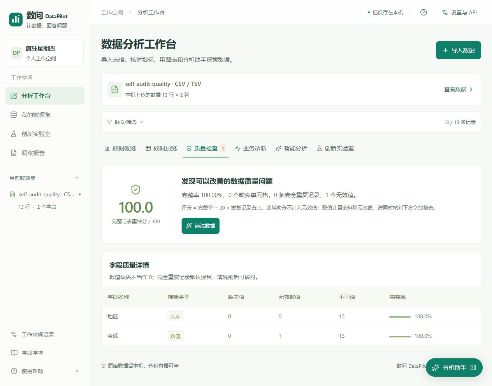
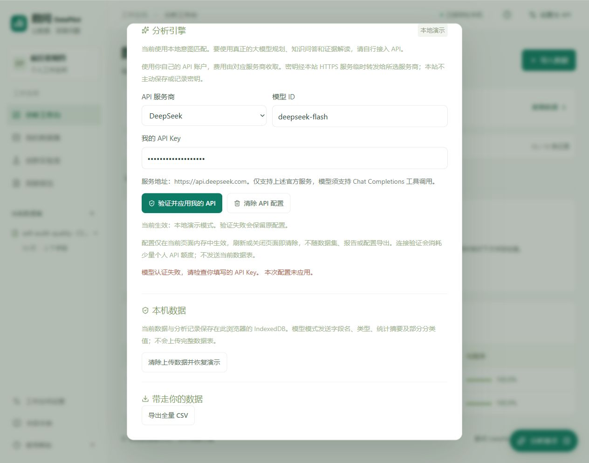
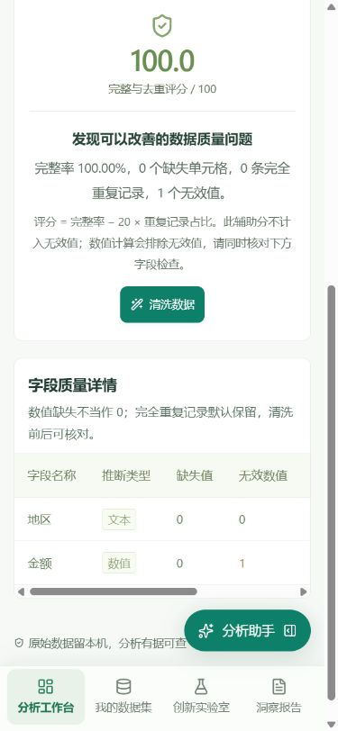

# v0.6.3 自查修复验收

2026-10-28，队伍：疯狂星期四。修复范围是自查确认的三处缺陷，不改变计算公式和既有真实模型评测源码。

## 修复与复测

1. 质量摘要原来只看缺失和重复，忽略无效数值。现在汇总字段无效值并警告，评分改称“完整与去重评分”，明确其不包含无效值；加大警告字号并提高对比度。13行合成样本完整率100%、无缺失重复，仍显示1个无效值；计算保留12个有效金额，合计780。
2. 个人API原来在验证前就替换全局配置。现在用候选请求头独立验证，HTTP与固定样本同时成功才应用；错误密钥、网络异常、格式错误及取消均不替换原配置。编辑、清除和卸载会取消，旧响应不能覆盖新配置。浏览器用虚构的无效测试密钥复测，显示“本次配置未应用”，生效状态仍为本地演示；截图不含真实密钥。
3. 无日期且只有一个文本维度时，首尾推荐问题重复并触发React键警告。现在按实际字段生成计数、最高与占比等不同问题，并最终去重。单文本、纯数值、日期数值、默认表和复现样本均验证问题可转成有效分析计划。

CSV按钮改为“导出全量CSV”，避免用户误以为只导出预览搜索结果。没有改变导出内容语义。

## 验证范围

- 122项业务/API及交互回归、7项仓库检查通过；TypeScript检查通过。
- 本地HTTP验证页面与静态资源、无个人凭据拒绝、非法服务地址拒绝；既有SSE与输入边界检查通过。2026-10-28个人DeepSeek的真实连接、规划、引用问答与证据导读检查通过。
- 8项新回归检查覆盖无效值、不同字段形状、验证失败、成功条件、网络/JSON错误、取消与旧响应竞态。
- 真实DeepSeek评测保留2026-10-26的31/31及智能分析10/10证据；本次没有重跑这些题集，计算和模型源码指纹未变。
- 浏览器实测桌面1264px与手机390×844；手机摘要换行完整、页面无整体横向溢出，字段表在容器内滚动。临时视口已复原。
- 发布与仓库的最终提交号、构建结果以Sites保存版本和GitHub Actions为准。团队资料与实际视频仍需补齐。

## 浏览器证据

