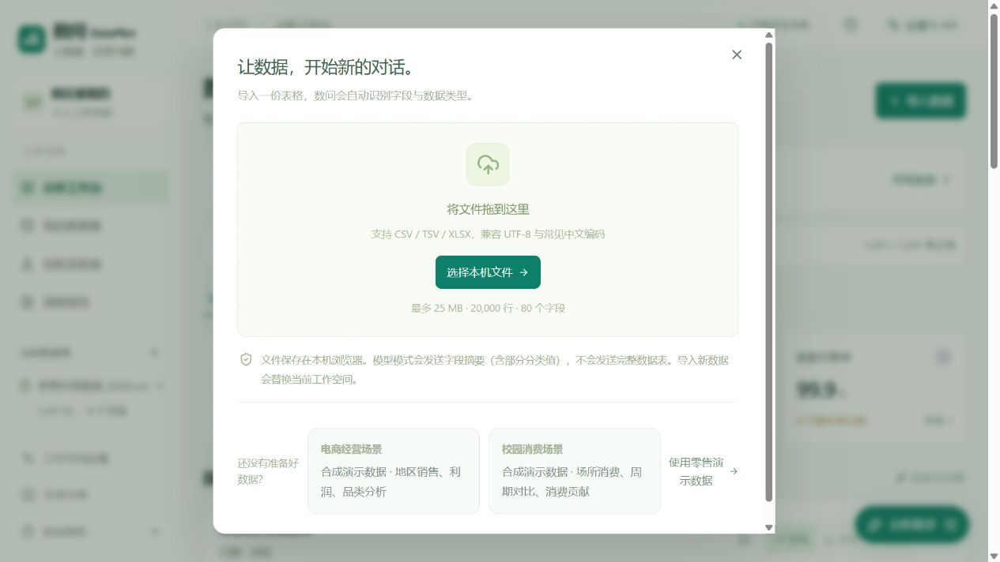
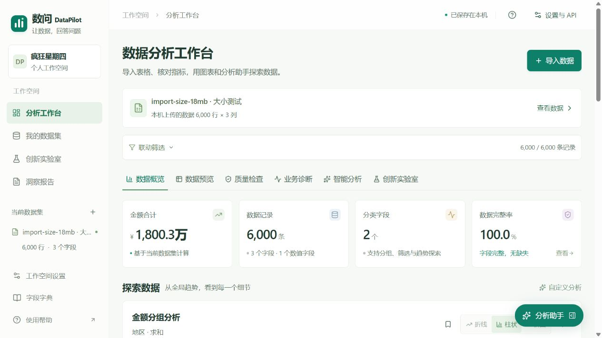
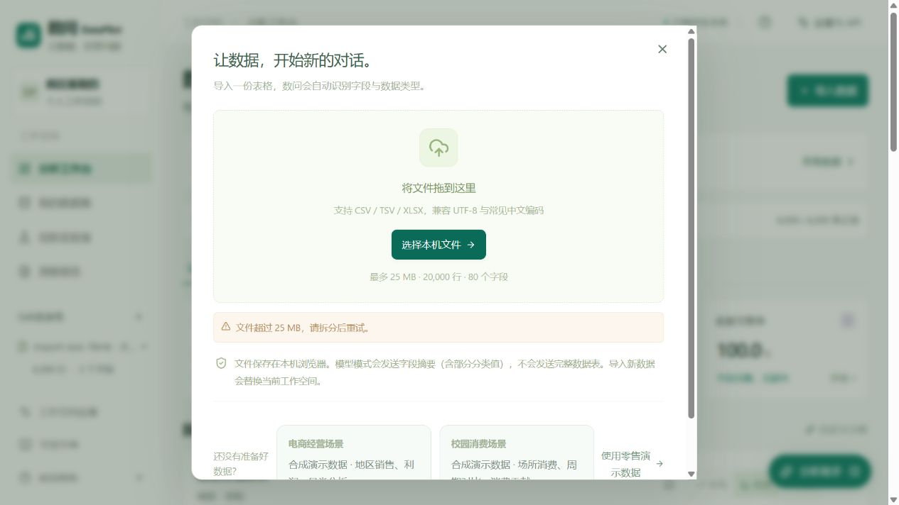

# v0.6.4 导入容量验收

2026-10-28。队伍：疯狂星期四，河南农业大学B组。

## 修改范围

CSV、TSV、XLSX单文件上限由5 MB提高到25 MB（25×1024×1024字节）。导入入口、文件向导及CSV解析复用统一大小校验，所有页面提示使用相同的容量标签。

继续保留20,000行、80列、工作簿声明展开64 MB和导入行JSON 30 MB限制。CSV解码后按UTF-8字节数也受25 MB限制，编码转换后超限需拆分。文件留在本机浏览器，未新增服务器文件上传或共享密钥。

## 实际验证

- 6,562,913字节CSV、18,276,149字节XLSX均在浏览器完成导入、字段确认和概览计算。两份文件均含6,000行、3列，金额合计18,003,000；华东9,000,000，华南9,003,000，无缺失指标。
- 26,214,401字节CSV（上限多1字节）被页面提前拒绝，提示25 MB，不替换已载入的数据。恰好25 MB的预检边界与中文UTF-8字节上限由单元检查验证，未将其描述为浏览器整文件性能基准。
- 新增2项核心回归，验证大于旧上限的CSV不丢行、长文本不截断、合计精确，以及新边界和UTF-8校验；现有行列限制与Excel声明展开过大拒绝检查仍通过。
- 124项业务/API/交互回归和TypeScript通过；仓库及生产构建结果见冻结提交对应的记录。
- 计算源码的容量常量发生变化，已重新执行31题真实DeepSeek回归，31/31通过；智能分析固定集10/10通过，含9项真实服务调用与1项无命中本机检查。证据在docs/evidence/，不代表通用准确率。

大文件试验使用合成数据；不承诺所有浏览器或所有25 MB文件都能在相同时长内完成。展开或数据规模触及其他上限时仍需拆分文件。

## 页面证据

