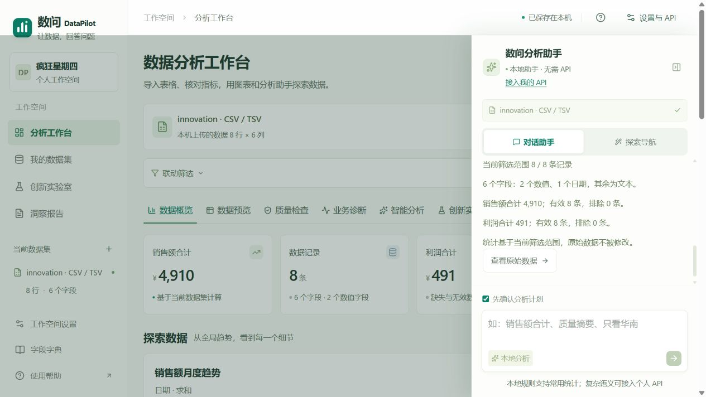
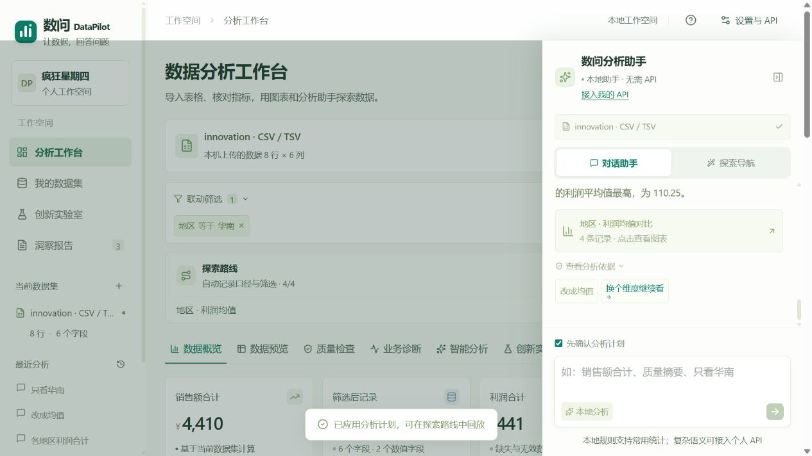

# v0.6.5 本地助手验收

2026-10-28。增加无需个人API的基础助手，现有25 MB导入与BYOK模型能力继续保留。

- 无API时，概览、质量、字段/字典说明、统计计划、连续分类筛选及数值上下界在浏览器执行，不调用模型或分析接口；界面明确标识本地规则。
- 提供数据概览、质量摘要、查看字段、怎么使用四个快捷入口；回答可打开原始数据、质量、报告中心、业务诊断及帮助。
- 未识别的字段、类别或条件、跨字段同值歧义、未定义比率、预测或因果不生成默认结论。日期文字区间提示先用筛选面板，不假装理解任意语义。
- 15项新增检查验证实际数值、上下文、清除与替换筛选、前五之外的分类、原表不变和不发网络请求。总计139项业务/API/交互检查，另有7项仓库检查。
- 浏览器在未配置API的状态实测概览与质量摘要；导入8行innovation样本后，概览给出销售额4910、利润491。“各地区利润合计→改成均值→只看华南”得到4条有效记录、均值110.25，保留利润与地区口径。
- 本地摘要是当前请求范围的快照，切换数据、口径或模型配置后清除；本地计划仍先确认再应用。摘要未自动写入统计报告，报告继续导出已确认的计算。
- 未修改模型适配与确定性引擎，真实模型证据沿用2026-10-28 v0.6.4的匹配指纹记录；本轮未重复调用真实题集。

