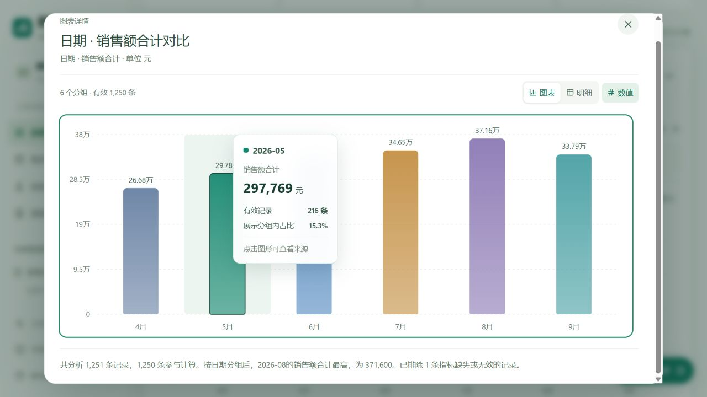
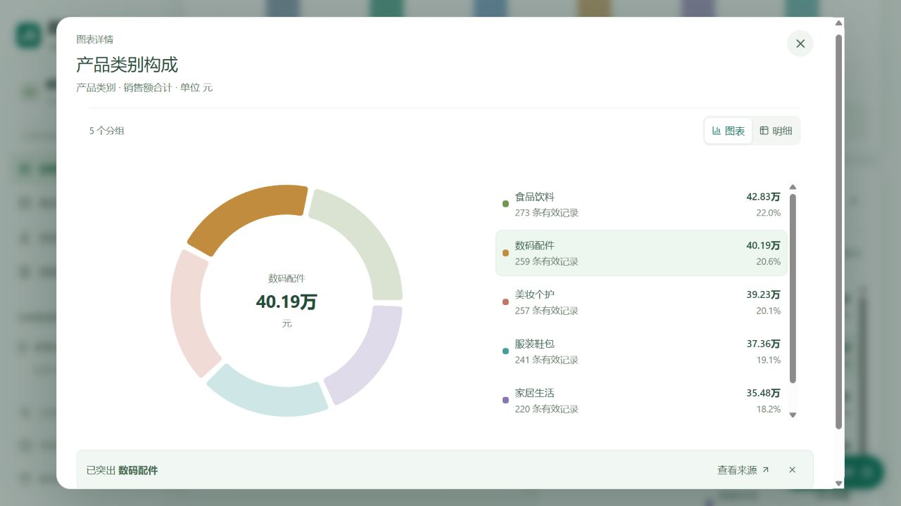
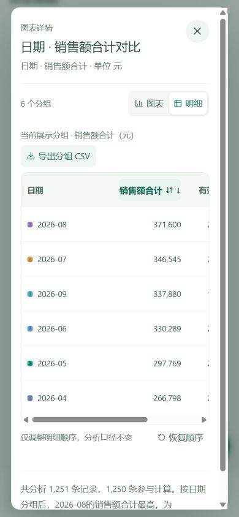

# v0.6.6 图表交互验收

2026-10-28。统一主图、地区分布与类别构成的展示组件，保留原有统计引擎与访客个人 API 机制。

- 调整配色、圆角柱、折线面积、坐标网格、数值标签和提示卡；图表支持放大、图表/明细切换、独立排序和分组 CSV。明细显示原始精度、有效记录与来源入口。
- 饼图图例支持突出显示、清除选择与来源回溯。占比仅针对当前展示分组；均值、极值、负数及全零数据不会生成误导性饼图。颜色在同一组集合中随排序保持稳定。
- 日期折线保留框选时间范围并确认应用；瀑布图支持点击或 Enter/空格打开实际分组来源；情景推演可突出基线或模拟序列，提示卡显示两值及差额，并标明不是预测。
- 浏览器核对主图键盘提示：2026-05 销售额 297769 元、216 条有效记录、展示分组内占比 15.3%。放大窗口明细降序首行为 2026-08、371600 元、217 条有效记录；来源跳转关闭放大窗口并打开对应 217 条记录。
- 类别构成选择数码配件后显示 40.19 万、259 条有效记录、20.6%；五类颜色可区分。390 像素布局验证图例堆叠、横向滚动明细和完整月份显示，避免日期被逐字折行。小尺寸密集图自动隐藏拥挤标签及对应开关。
- 业务诊断瀑布图使用键盘打开西南分组的 84 条来源；情景推演突出模拟值后，2026-04 提示显示基线 266798、模拟 293477.8、差额 26679.8。测试浏览器未捕获控制台错误。
- 新增 8 项展示规则检查，覆盖展示分母、无效饼图、非有限值、不可变排序、框选边界、CSV 精度/公式防护及稳定配色。业务/API/交互检查共 147 项，另有 7 项仓库检查；类型检查通过。
- 分组 CSV 内容由自动检查核对；浏览器下载事件等待曾超时，因此未把文件实际落盘记为已验证。界面只提示已生成 CSV，不宣称文件已保存。
- 未改统计、智能体与模型适配库；真实模型证据沿用 2026-10-28 匹配源码指纹的记录，本轮未重复调用真实模型题集。视频仍由团队另行准备。

生产构建、公开仓库提交核对和部署结果以本版本构建记录、GitHub Actions 与提交包的版本清单为准。

