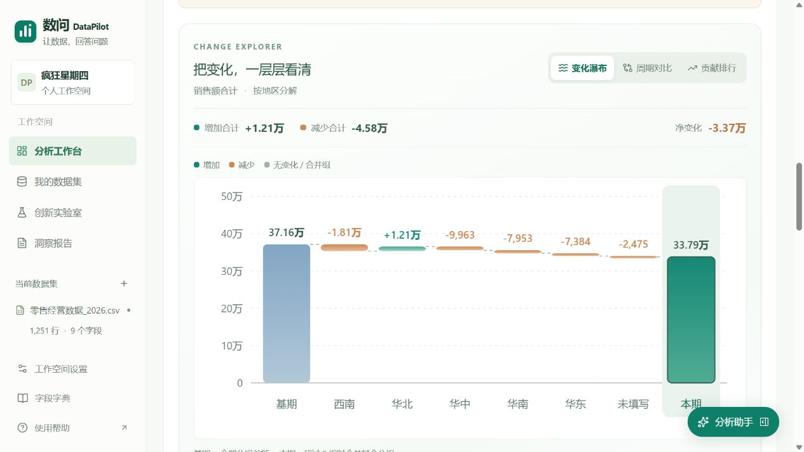
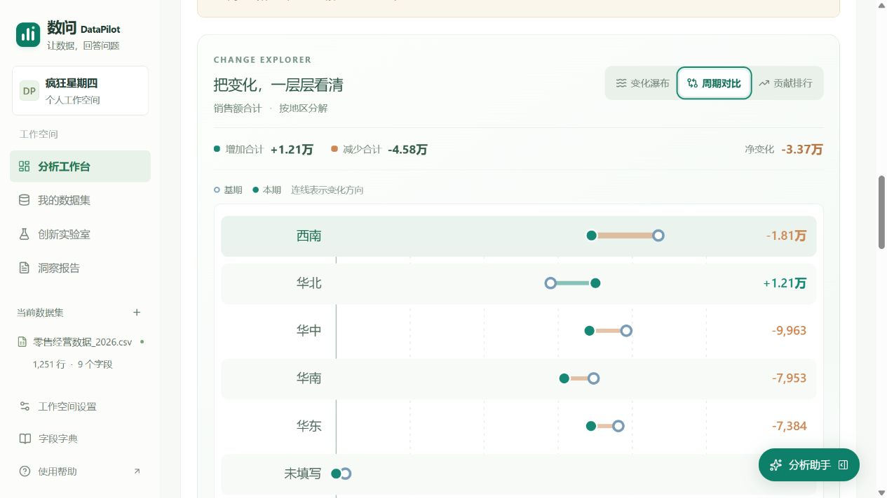

# v0.6.7 诊断图表验收

2026-10-29。优化业务诊断的图表层，原始统计、筛选与模型接口保持不变。

- 新增变化瀑布、周期哑铃对比、正负贡献排行三个视角。分组可悬停预览、点击或按Enter/空格选中；视角支持方向键及Home/End。摘要用日期、有效记录、基期蓝色与增减配色区分含义。
- 选中详情保留精确基期、本期与差额，可分别核对两个周期的来源。颜色仅表达数值增减，不代表业务好坏，不从分组差额推断原因。
- 瀑布图保留零点、网格、圆角渐变柱和累计连接线；超过8组时合并其余分组。合并项显示数量与合计差额，不绑定虚构单组来源。
- 对比图与排行每页8组，可查看全部分组；排行支持只看增加或减少。排序、方向筛选、翻页与图表选择均不改动计算结果、全量导出和原始记录。
- 内置合成数据本期2026-09-01至09-25、基期2026-08-01至08-31。页面显示基期371600、本期337880、净变化-33720，保留周期天数不同的核对提示。
- 浏览器核对华北基期57929、本期70046、差额12117；键盘选中后打开本期来源，共37条。排行只看增加时只保留华北，净变化与全量贡献表继续按全部分组显示。
- 按订单编号分解得到392组。瀑布图“其余385组”差额-30102，选中后无单组来源按钮；对比图49页，第二页选中DP001116，基期0、本期3416、差额3416。
- 390像素窄屏无整页横向溢出；图表720像素内容在独立容器滚动，标签保持可读。详情显示完整数值与两个来源按钮。浏览器未捕获控制台错误。
- 新增5项展示规则检查：跨零累计、合并项与同名真实分组隔离、负值/全零坐标与刻度、排序方向不改统计及正负合计对账。现有152项业务/API/交互检查，另有7项仓库检查；类型与生产构建结果以本版构建记录为准。
- 未修改真实模型评测涉及的统计及模型库，沿用2026-10-28匹配源码指纹的记录；本轮未重复请求真实题集。实际演示视频仍由团队准备。

