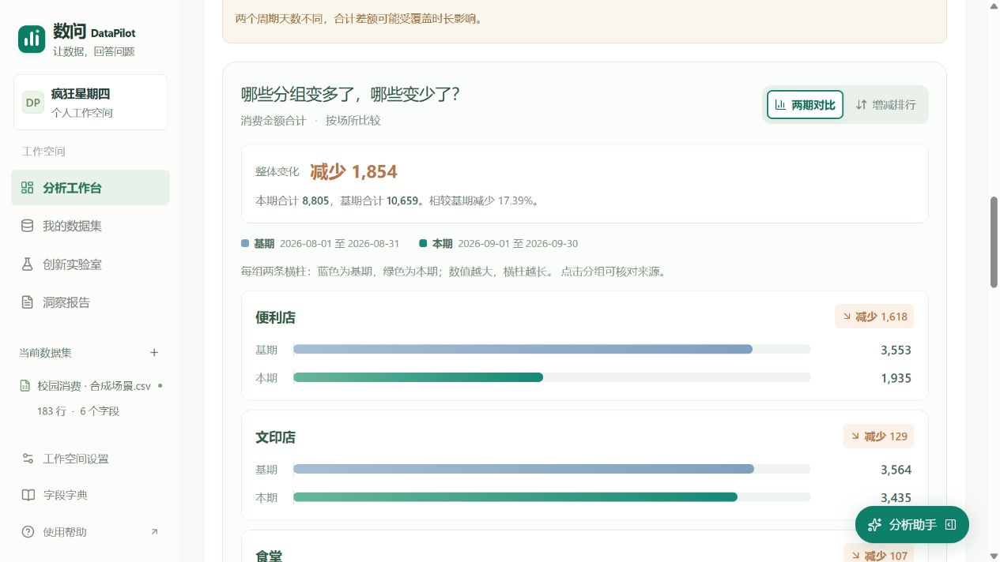
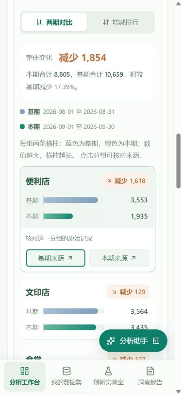

# v0.6.8 易读诊断图表验收

2026-10-29。根据校园消费截图反馈，诊断默认改为每组两条横柱，直接显示基期、本期及增减文字；保留增减排行与来源核对。

- 两期对比在每组旁显示完整数值，蓝色代表基期、绿色代表本期；分组右侧写“增加”“减少”或“没有变化”。顶部以一句话概括整体变化，并展示两个周期实际日期。
- 所有分组和分页共享一个包含零点的刻度，负值向零线左侧延伸，零值长度为零。默认每页6组；不合并为虚构类别。排行可按增减方向筛选，原始统计和全量导出不受影响。
- 展开分组卡片即可打开两期来源，支持键盘Enter和Tab；视角保留方向键与Home/End切换。手机使用自适应横柱，数值保留在柱外，无需横向滑动图表。
- 浏览器载入183行校园消费合成场景。本期2026-09-01至09-30、基期2026-08-01至08-31，显示本期8805、基期10659、减少1854及17.39%。周期天数不同的核对提示保留。
- 便利店基期3553、本期1935、减少1618；文印店3564至3435、减少129；食堂3542至3435、减少107。键盘展开便利店后，本期来源显示30条有效记录。
- 订单编号183组可分31页；第二页显示第7至12组，其中C9040基期0、本期128、增加128，C8040基期128、本期0、减少128。
- 390像素布局实测页面内容宽375像素、可用宽375像素；每条横柱行内容宽265像素、可用宽265像素，无横向溢出。完整显示便利店两期数值、增减文字及来源按钮，未捕获浏览器控制台错误。
- 两项旧图形检查替换为双柱共享刻度（正数、负数、零值与比例一致）及明确增减文字检查。图表展示仍为13项；全部业务/API/交互为152项，加7项仓库检查共159项。类型检查通过；生产构建和GitHub自动检查以本版实际记录为准。
- 统计和模型库未改，真实模型证据沿用2026-10-28匹配指纹记录，本轮未重复请求真实题集。视频由团队另行准备。

