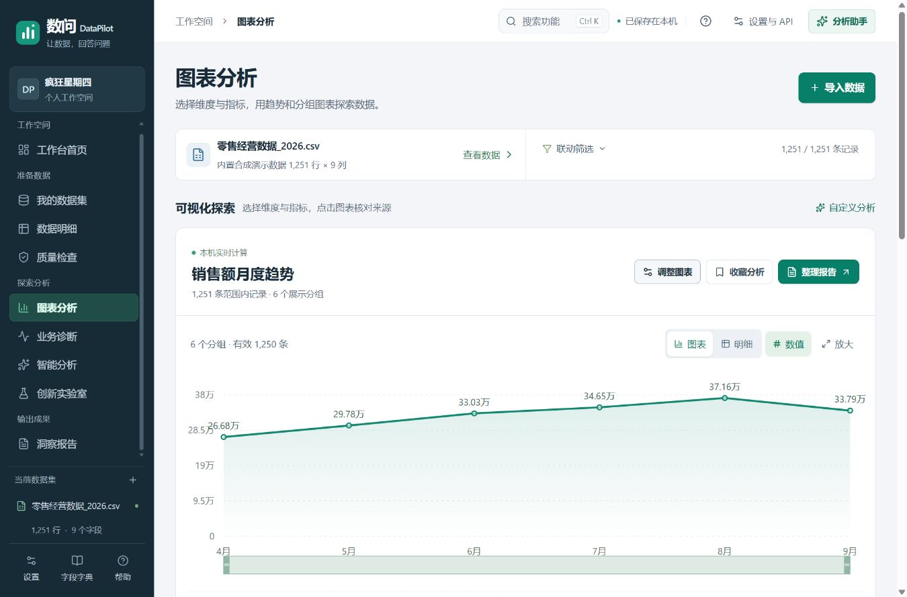

# 数问 DataPilot 产品介绍

版本 v0.7.0 · 2026-11-16

河南农业大学 · B组 · 疯狂星期四
队员 刘宗柯、陈世航、刘兴海　指导老师 唐琦

数问 DataPilot 面向课程实验、校园活动和小规模业务表格分析，把导入、质量核对、提问分析、来源追溯和报告整理连接成一个可操作的工作流程。当前交付为 v0.7.0 本地作品及配套源码，视频由团队另行录制。

## 项目定位

用户可以上传自己的 CSV、TSV 或 Excel 文件，在浏览器中检查与计算数据；基础问答无需配置 API。接入个人模型服务后，可使用生成式理解与复杂规划，最终统计仍由确定性引擎执行。适用范围是单表探索性分析，不替代数据库平台或专业因果分析工具。

界面按准备数据、探索分析、输出成果组织导航。首页提供问题入口和可恢复的分析，详细工具分布在独立页面，避免将全部功能堆叠在同一屏。

## 项目使用方式

| 页面 | 主要用途 |
| --- | --- |
| 工作台首页 | 查看概况、输入问题、使用场景模板、搜索和恢复已有分析。 |
| 我的数据集 | 导入和切换本机项目，按名称搜索、排序，备份与恢复项目。 |
| 数据明细 | 全文搜索、排序、显示列选择、分页和当前结果 CSV 导出。 |
| 质量检查 | 定位缺失、无效值、重复和规则违规记录；清洗前预览并支持撤销。 |
| 图表分析 | 调整维度、指标和聚合方式；选中分组、放大图表、查看来源。 |
| 业务诊断 | 比较两个时期，查看分组增减和两期来源，提示周期覆盖差异。 |
| 智能分析与创新实验室 | 多步骤分析、业务文档引用问答、异常核查及算术情景推演。 |
| 洞察报告 | 选择章节、调整顺序、填写批注、标记核验、演示和导出。 |

## 建议首次操作路线

打开首页后，可直接使用内置合成样例；也可点击“导入数据”，选择文件并确认字段。先到质量检查核对数据，再从首页提问或在图表页配置分析。点击来源入口核对记录后收藏结果，最后到洞察报告编辑与导出。

在“设置与 API”中可自行配置模型服务。密钥只在当前页面内存中生效，刷新后需重新配置；不用 API 时，本地助手、图表、质量检查和报告仍可使用。

文件上限为 25 MB、20,000 行、80 列，三个限制同时生效。数据保存在当前浏览器中，换设备前请导出项目备份。

## 项目亮点

可核对的分析过程。分析计划展示维度、指标、聚合与筛选，用户确认后执行。图表不仅给出数字，还提供有效记录数、排除说明与来源入口，便于判断结果是否符合问题。

可撤销的质量处理。缺失、重复与无效值可定位到记录；清洗先预览影响，再执行与复检。用户还可设置必填、字段唯一、数值范围、允许值四类业务规则。

连续的分析工作。数据集库、最近分析、收藏、报告草稿与项目备份衔接使用。同一项目可在多个页面间切换，保存失败和多标签冲突会明确提示。

清晰的展示与交付。图表设置可收起，保留更大的展示区域；最近分析与收藏可按名称、维度或指标搜索。报告支持章节排序、批注和演示模式，不必临时拼接截图。

## AI 测试技术落地使用情况

AI 应用落在问题理解、受限分析计划生成、多步骤规划、证据选择和业务文档引用问答。程序使用固定工具结构、真实字段白名单与 Zod 校验模型返回；不执行模型生成的任意代码，也不直接采纳模型编写的统计数值。

开发中使用 AI 辅助界面与代码迭代、测试用例草拟及文档整理，效果以实际运行和人工核对为准。当前并未实现通用的 AI 自动测试平台，不把规则匹配或自动化测试称为大模型推理。

已有历史真实模型评测记录：2026-10-26 的固定计划题集 31/31 通过。该记录只代表当时模型、源码和样本。本轮未重新调用外部模型，不能据此声称当前所有 API 功能已完成实时复测。

## 关键技术与验证

| 技术 | 在项目中的作用 |
| --- | --- |
| React 与 TypeScript | 组件化页面、类型约束、共享工作空间和九个页面地址。 |
| Vinext 与 Vite | 本地开发和生产构建；服务端路由处理访客模型请求。 |
| Recharts | 柱状、趋势与占比图表，交互选择、明细和放大展示。 |
| Web Worker | 在可终止后台任务中解析、剖析或进行较重的数据计算。 |
| IndexedDB | 保存数据与配置，支持迁移、事务回滚及多标签冲突检测。 |
| Zod 与受限工具调用 | 验证计划结构、合法字段与参数，隔离语言理解与数值计算。 |
| 本机文档检索 | 中文双字词项与 TF-IDF 稀疏向量检索，回答附原文引用。 |

本轮运行 211 项自动检查，TypeScript 类型检查与生产构建均通过。自动检查覆盖计算、规则、备份、恢复、导出与存储失败等行为；界面交互另外通过桌面和 390 像素手机视口核对。详细证据随包提供。

## 可复现的演示数据

内置合成零售样例包含 1,251 条记录、9 个字段。未清洗且无筛选时，销售额合计 1,950,881，1,250 条参与该指标计算，排除 1 条缺失或无效指标。质量检查可见 6 个缺失单元格和 3 条整行重复。以上是功能样例，不代表真实经营数据。

## 项目界面

## 此前发表与获奖情况

根据团队确认，本项目此前未发表、未获奖。公开代码仓库用于作品展示与评审，不表述为论文发表或赛事获奖。

## 开发基础与优化说明

根据团队确认，本项目不是在他人项目、已有课程项目或现成开源项目上二次开发。项目使用通用开源依赖，具体许可证见附带的第三方依赖说明。

界面组织参考 Metabase 的分析配置、Hex 的分析复用及 Rows 的问题入口，保留数问自身品牌与实现，未复制第三方商标、页面素材或源码。本版本在自身前期代码上增加独立页面、业务规则、项目备份、报告草稿及更清晰的工作流。

产品边界：本机存储不等于云同步；质量或规则通过不等于业务事实正确；异常提示、周期分解和情景推演不自动构成因果结论或预测。本地最新源码与文档已统一，原在线地址和公开仓库尚未同步本次快照。
