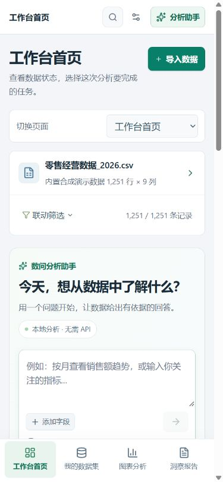
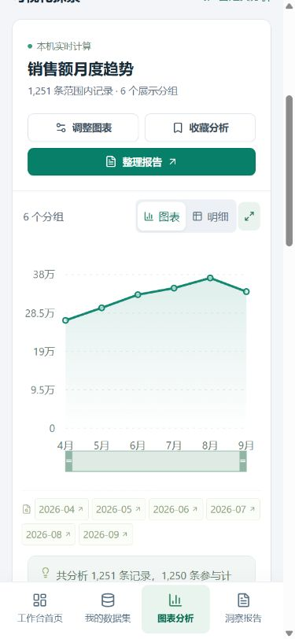
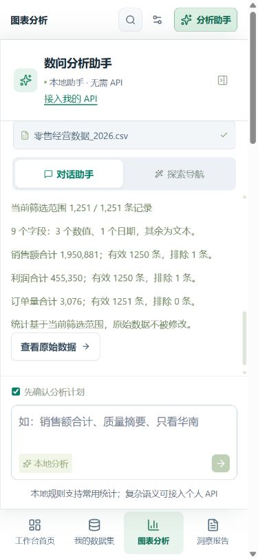
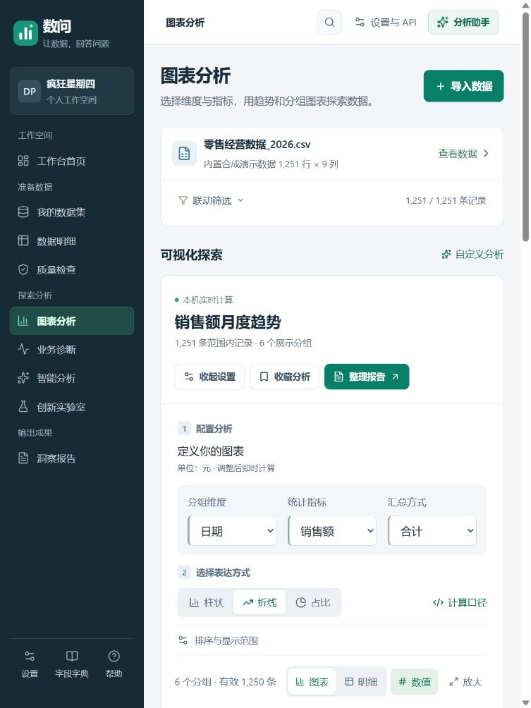
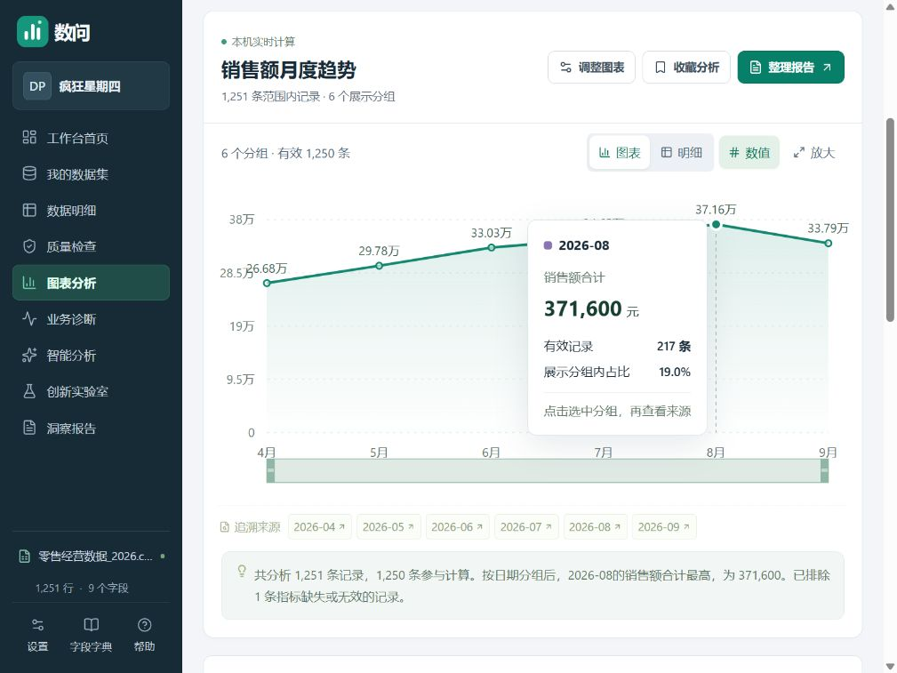

# 手机与平板适配：演示与验证

版本 v0.7.0；验证日期 2026-11-16；本地地址 `http://localhost:5173/`。本轮是浏览器视口验证，并非 iPhone、iPad 或 Android 真机兼容性认证。

## 对应哪些评分点

赛事发布者在[赛氪发布的本届 AI WEB 赛道说明](https://m.saikr.com/vse/2026AIWEBKF)将响应式适配列入“UI设计与视觉表现”（权重 4%），属于“用户体验”（10%）维度；同一维度还考察前端交互体验（3%）和 AI 交互体验（3%）。响应式适配是有依据的评分展示点，不是做完就固定额外加 4 分。录制时仍应优先保证核心 AI 工作流的演示时间。

查阅日期 2026-11-16。本轮官网动态详情未能由检索工具直接读取，以上权重依据赛事发布者的赛氪页面；最终执行以[官网赛道及提交入口](https://www.boxuegu.com/matchTrack/detail/?id=10037)公布的细则为准。

## 这次实际验证了什么

使用同一份内置零售合成数据，共 1,251 行、9 个字段。仅切换视口与操作页面，不切换数据或制造另一套移动端统计结果。

| 场景 | 浏览器视口 | 实测结果 |
| --- | --- | --- |
| 手机竖屏 | 390 × 844 | 底部常用导航和包含九页的页面选择器可用；从首页切换图表页；收起设置后显示图表；打开八月来源明细看到 217 条；关闭后可打开助手并返回本地概览。 |
| 平板竖屏 | 768 × 1024 | 保留侧栏导航，图表配置排在图表上方；选择框和操作区在内容宽度内排列；此前手机设置和当前数据保留。 |
| 平板横屏 | 1024 × 768 | 旋转模拟后导航、图表重新布局；收起配置可查看完整趋势和数值；八月合计为 371,600，来源 217 条。 |

页面滚动宽度分别为 375、753、1009 CSS 像素，小于对应视口宽度，三种场景均无整页横向溢出。差额来自浏览器滚动条。手机来源表格内容宽 737、容器宽 277 像素，使用内部横向滚动，保留字段而不挤压整页。图表无需整页横向拖动，数据表可在自身区域横向查看。

手机助手“数据概览”返回销售额合计 1,950,881，1,250 条有效记录、排除 1 条；页面明确标记“本地计算 · 未调用模型”。本轮没有调用外部模型，也未核验手机软键盘、触摸手势、Safari 或真实设备性能。检查期间未捕获浏览器控制台 error。验证结束后已恢复正常浏览器尺寸。

## 建议加入视频的 40 秒片段

以现有约七分钟讲稿为基础，压缩重复介绍，给此片段留出 40 秒，成片仍保持 5–8 分钟。录制画布保持至少 1920 × 1080；手机页面显示在其中，不把最终视频导出成 390 像素宽。桌面浏览器开发者工具可用设备工具栏设置下列尺寸，画面标注“浏览器响应式模拟”。

| 时间 | 操作 | 证明的体验 |
| --- | --- | --- |
| 0–8 秒 | 展示桌面图表，然后切换 390 × 844。 | 同一应用和数据按屏幕重排。 |
| 8–20 秒 | 使用底部图表导航，收起设置，点击八月来源并关闭。 | 小屏可实际操作，图表与证据仍可读。 |
| 20–30 秒 | 打开分析助手，点击“数据概览”，再收起。 | 助手按需出现，不长期挤占小屏空间；基础能力无需 API。 |
| 30–40 秒 | 改为 768 × 1024，再改 1024 × 768，展示图表。 | 平板横竖屏重排，数据和配置保留。 |

可以直接讲：

> 我们为桌面、平板和手机分别调整了布局。手机使用底部导航，九个功能页面仍可通过页面选择器进入；图表设置可以收起，来源明细在独立窗口中核对。分析助手按需打开，基础统计无需 API。平板横竖屏切换时，布局会重新排列，同一份数据和分析配置保持不变。这里展示的是浏览器响应式验证。

如使用实际手机或平板补录，标注真实设备、系统和浏览器版本，并检查输入、触摸、横竖屏和文件导入。验证完成前不要写“已通过所有主流移动设备”。本机存储按浏览器独立保存，跨设备需要导入数据或备份；不要演示成已实现云同步。

## 截图证据

手机首页、图表和助手均来自实际运行页面：

  

平板竖屏配置与横屏图表：

